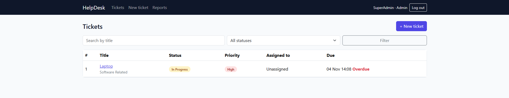
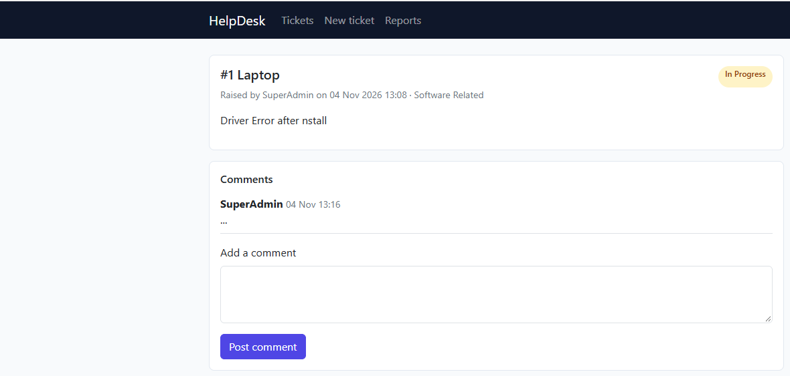
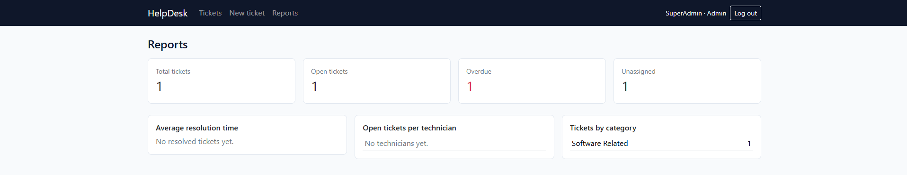

# IT Helpdesk Ticketing System

Individual Student Project, Project 8. Built by [Antonie Potgieter], student number [20260249] in collaboration With Cluade LLM

A web application where employees log IT problems, an admin assigns them to technicians, and technicians work them through to resolution. Every status change and comment is kept as a history, and tickets have target resolution times (SLAs) based on priority.

## Features

- Register, log in and log out (passwords hashed with Django's PBKDF2)
- Three roles: Employee, Technician, Admin
- Log tickets with title, description, category, priority and optional screenshot
- Status workflow: Open, Assigned, In Progress, Waiting on User, Resolved, Closed
- Admin assigns tickets to technicians
- Comments and a full status history on every ticket
- Target resolution times by priority (High 4h, Medium 24h, Low 72h); overdue tickets highlighted
- Search and filter tickets
- Admin reports: open tickets per technician, average resolution time, tickets by category
- Responsive interface (laptop and phone)

## ScreenShots

## Screenshots

## Tech stack

Python 3, Django, SQLite, Bootstrap 5.

## How to run (about 5 minutes)

1. Install Python 3.11 or newer.
2. Open a terminal in the project folder and run:
**python -m venv venv**
**venv\Scripts\activate**
**pip install -r requirements.txt**
**python manage.py migrate**
**python manage.py seed**
**python manage.py runserver**

On Mac/Linux, use `source venv/bin/activate` instead of `venv\Scripts\activate`.

3. Open http://127.0.0.1:8000/

`python manage.py seed` loads sample categories, SLA policies, users and tickets.

## Test logins

| Role | Username | Password |
|---|---|---|
| Admin | admin_demo | Admin@12345 |
| Technician | tech_sam | Tech@12345 |
| Technician | tech_lee | Tech@12345 |
| Employee | emp_amy | Employee@12345 |
| Employee | emp_ben | Employee@12345 |

The admin site is at http://127.0.0.1:8000/admin/ (log in as `admin_demo`).

## Running the automated tests
**python manage.py test**

There are 24 tests covering SLA deadlines, the status workflow, role-based access, validation and password hashing. Results are saved in `docs/test_results.txt`.

## Project structure

- `config/` Django settings and main URLs
- `tickets/models.py` database models and business rules
- `tickets/views.py` request handling and role checks
- `tickets/forms.py` forms with server-side validation
- `tickets/tests.py` automated tests
- `tickets/management/commands/seed.py` sample data
- `templates/` HTML templates
- `static/css/style.css` styling

## Libraries and licences

| Library | Purpose | Licence |
|---|---|---|
| Django | Web framework | BSD 3-Clause |
| Pillow | Image uploads (screenshots) | HPND |
| Bootstrap 5 (via CDN) | Responsive layout | MIT |

## AI tools and copied code declaration

I used an AI assistant (Claude) for [describe honestly: planning, generating starter code for models, views, forms, templates and tests, and debugging errors]. I read and tested all of this code and can explain it. No code was copied from other students.

## Known issues

- [List any bugs or limits, for example: no email notifications; screenshots are not resized.]